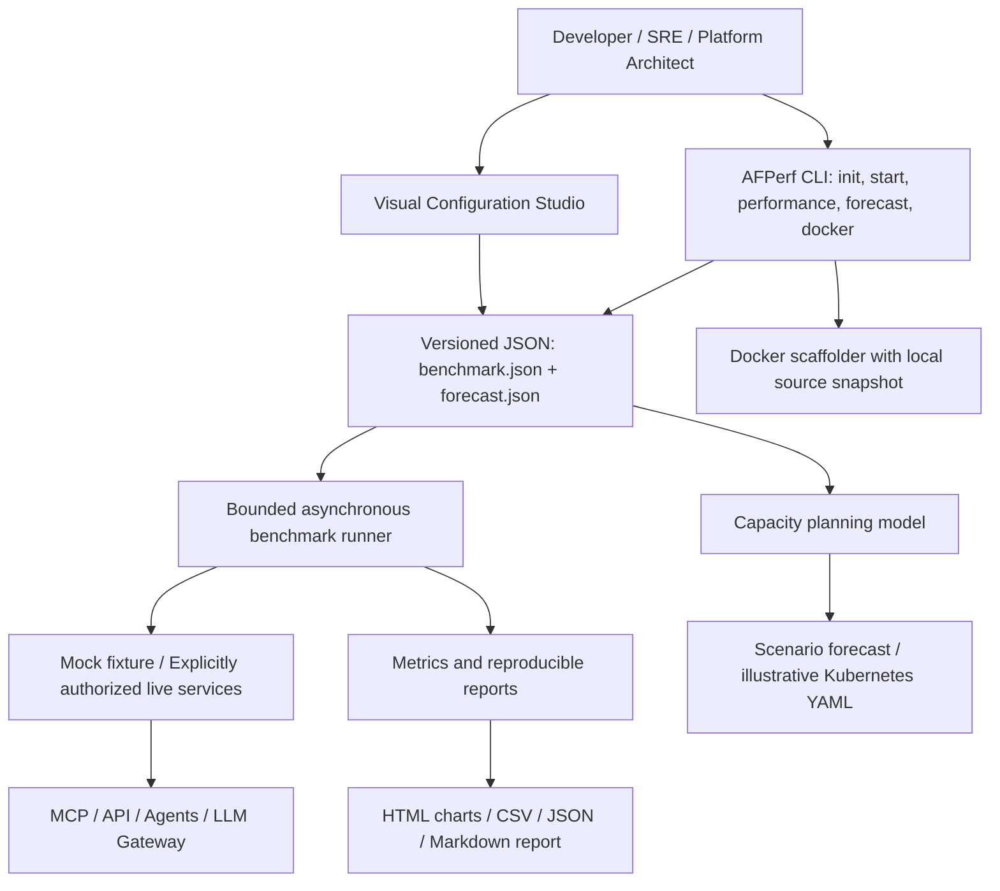

# AI Forest Agent Performance Test (AFPerf)
## From Agent Workload Evaluation to Evidence-Based Infrastructure Planning

**Product white paper · Version 0.6 · 19 November 2026 · AI Forest Inc.**

> **Status:** Engineering prototype and product proposal. Benchmarks run against mock services demonstrate software functionality, **not** production readiness, third-party adoption, or verified Kubernetes resource requirements. The original AFPerf code carries the Apache License 2.0, with AI Forest copyright attribution and independent trademark rights.

### Executive summary

Agentic applications combine language models, retrieval, memory, APIs, Model Context Protocol (MCP) tools, orchestration runtimes, and infrastructure services. Teams can benchmark an API in isolation, but reliable production planning requires understanding the *whole agent workload*: tool discovery overhead, fan-out, rate limits, inference latency, token use, error propagation, concurrency, and the resources required when user adoption rises.

**AI Forest Agent Performance Test (AFPerf)** is a Python-first, locally deployable engineering toolkit connecting three jobs:

1. **Define and run a representative test.** Use a visual designer or versioned JSON to describe MCP, REST, agent, and LLM-gateway targets; run smoke, load, ramp, or bounded soak workloads.
2. **Interpret operational evidence.** Record request outcomes, p20/p50/p95/p99 latency, throughput, failure counts, and streaming first-token latency when measurable; produce reproducible reports and visual explanations.
3. **Translate demand into an infrastructure hypothesis.** Combine measured or assumed RPS per pod with expected users, workflow fan-out, utilization and headroom, then generate a forecast and illustrative Kubernetes objects.

The goal is not to replace established high-scale traffic generators or observability products. It is to make **AI-aware performance engineering and infrastructure planning easier to configure and understand**, with a workflow suitable for developers, platform engineers, architects and SRE teams.

### The problem

A user request to an AI agent may execute several model calls, Redis memory lookups, MCP operations and external API requests before returning a response. A 200 ms gateway response cannot establish that the overall agent completes within an SLO. Different model deployments may saturate on token generation or provider quotas while the HTTP gateway remains idle. Similarly, increasing the number of Kubernetes gateway pods cannot resolve inadequate GPU serving throughput.

Conventional capacity estimates often mistake registered users for concurrent users, requests per second for workflows per second, and client load-generator workers for production server pods. Testing every layer with separate scripts also fragments the evidence needed for release decisions.

### Product architecture



AFPerf v0.6 provides local project scaffolding and installation via Python wheel. The bundled Streamlit dashboard is launched through the `afperf start` command. Credentials can be stored in a local `.env` file and are excluded from the generated example configurations and normal reports. Docker scaffolding creates an **offline build context** that copies application source and sanitized configuration—not `.env` secrets.

### Evidence and measurement

The prototype currently supports:

- **MCP:** protocol-aware discovery and read-only tool calls; explicit protocol version selection for the supported variants.
- **REST/agent endpoints:** configurable URL, method, JSON payload, expected HTTP status and response checks.
- **LLM gateway:** model selection, synthetic prompts, non-streaming and streaming requests, token usage where provider reports it, and time-to-first-content-token when streaming works.
- **Traffic:** smoke, load, ramp and soak test shapes with bounded request counts and concurrency; live traffic requires explicit approval and rate limits.
- **Results:** raw request CSV, summary JSON, Markdown report, PNG charts and interactive HTML plots.

Successful-request latency percentiles are not a substitute for error-rate reporting. A p99 computed from a few dozen requests is unstable; a production SLO demands sufficient samples, distribution-aware analysis, controlled environments, and repeated tests. A hypothetical or mock token count is not evidence of a physical model's inference throughput.

### Forecast methodology

The forecast deliberately separates user adoption assumptions from measured service capacity:

```
Peak workflow TPS = registered users × peak active fraction
                   × workflows per active user per minute / 60
                   × burst multiplier
Service RPS = Peak workflow TPS × operations per workflow
Estimated pods = max(HA minimum,
   ceil(Service RPS / (measured-or-assumed RPS per pod × utilization target)
        / (1 − reserved headroom)))
LLM token demand per minute = LLM calls per second × tokens per call × 60
```

Forecasts **do not** auto-learn RPS per pod from one endpoint benchmark, and **do not** include actual GPU capacity, model/provider quota ceilings, platform control-plane overhead, storage dependencies, or production network topology. Generated Gateway API, Deployment, Service, HPA and optional KEDA examples require review and customization. HPA and KEDA are alternative controllers when targeting the same Deployment.

### Safety and security design

AFPerf's intended workflow is controlled and local-first. Live tests require explicit authorization; concurrency and request-rate limits are enforced; the default configuration is mock-only. Users must own the destination or have permission to test it. MCP mutating-tool names are guarded, but **name-based filtering is not proof of read-only semantics**: users should test against dedicated synthetic data and independently verify permissions. A test aimed at a live model can incur cost. Secrets belong in local environment variables, not benchmark JSON, screenshots, reports or version control. The dashboard is **not currently a hardened public multi-tenant service** and should be bound to localhost by default.

### Why a team might adopt AFPerf

**Developer:** create repeatable tests without writing bespoke load-generation code; compare MCP tools and gateway models with the same prompts.

**Platform engineer:** set an error/latency target, observe the p95/p99 impact of increasing concurrency, and maintain a versioned benchmark suite in the application repository.

**Architect / SRE:** connect observed workflow fan-out and safe per-pod throughput to infrastructure sizing, then prepare an actionable Kubernetes capacity proposal.

**Engineering manager:** review a single report covering expected scale, assumptions, test evidence and gaps before committing to cloud spending.

### Competitive positioning (public documentation; comparison, not lab evaluation)

| Product | Known strength | AFPerf's plausible differentiation | Honest limitation of AFPerf today |
| --- | --- | --- | --- |
| Grafana k6 | Scenarios, load thresholds, performance-as-code | Purpose-specific MCP/LLM test forms plus K8s capacity hypotheses | AFPerf lacks k6's mature distributed execution, protocol breadth and production tooling |
| Locust | Python workloads, browser UI, distributed runners | No-code AI target selection and built-in capacity report templates | AFPerf has a bounded, local-only traffic generator, not a distributed swarm |
| LangSmith | Agent evaluation, datasets, experiments and traces | Adds quantitative concurrency tests and capacity planning | AFPerf does not replace curated evaluation datasets or deep trajectory analysis |
| Langfuse / Arize Phoenix | AI traces, observability, evaluation workflows | Complement their telemetry with workload simulation and pod forecasts | AFPerf does not yet implement comprehensive tracing/online production evaluation |
| promptfoo | LLM correctness, security and red-team evaluation | Supply independent latency and infrastructure evidence | AFPerf is not a red-teaming framework |

**Opportunity hypothesis:** a narrow focus on MCP/agent performance, plain-language visuals, portable CLI, and the connection between load profiles and Kubernetes resource assumptions can be useful to teams integrating many model and tool providers. **Not a validated market-share or competitive-performance claim.**

### Architecture and commercialization roadmap

**v0.6 — prototype release:** Python package, commands, dashboard, JSON generator, mock/live controlled benchmarks, Kubernetes forecast, reproducible reports, and offline Docker scaffolding. Static Docker configuration is tested; a real `docker build` and Streamlit browser interaction remain unverified in this environment.

**v0.7 — operational hardening:** CI release gates and assertions, deterministic workload versioning, secrets-manager adapters, OpenTelemetry trace/metric correlations, normalized LLM tokens per second, realistic MCP workload replay, deeper failure taxonomy, per-model throughput curves, container integration tests and version-locked dependency builds.

**v0.8 — team workflows:** RBAC, SSO, workspace isolation, centralized encrypted secret storage, queued test jobs, multi-worker execution, scheduling, run histories, exportable policy/approval records and trustworthy SLO gate calculations.

**v1.0 — enterprise readiness target:** repeatable production-like staging results, load-generator scaling, Kubernetes-specific infrastructure validations, cost models, compliance/privacy assessment, pen test, supply-chain provenance, support/SLA and published release notes.

### License and business model

AFPerf community-core software is licensed under **Apache License 2.0**, with AI Forest Inc. attribution and trademark rights retained separately. Permissive open-source licensing allows commercial reuse; an optional commercial hosted service or enterprise extensions could be offered under separate agreements without changing the Apache-2.0 grant for community-core code. Third-party licenses remain their own.

### Suggested launch demonstration

1. `pip install` the local wheel and run `afperf init demo-project`.
2. Start the dashboard via `afperf start` and build a synthetic MCP/LLM suite visually.
3. Export `benchmark.json`, then run the mock benchmark with `afperf performance benchmark.json`.
4. Show the latency plot axes, p95/p99 behavior, errors and CSV evidence.
5. Generate `forecast.json` and run `afperf forecast forecast.json` across user-growth assumptions.
6. Run `afperf docker`, inspect the generated Dockerfile, `src/`, Compose and `start.sh`. Demonstrate a real container only after validating Docker on the target host.
7. State which results are measured, which are simulated, and which are assumptions.

### Public reference links

- Grafana k6 thresholds and scenarios: https://grafana.com/docs/k6/latest/using-k6/thresholds/ ; https://grafana.com/docs/k6/latest/using-k6/scenarios/
- Locust documentation: https://docs.locust.io/en/stable/ ; https://docs.locust.io/en/stable/running-distributed.html
- LangSmith evaluation types: https://docs.langchain.com/langsmith/evaluation-types
- Arize Phoenix: https://arize.com/docs/phoenix/
- promptfoo LLM red teaming: https://www.promptfoo.dev/docs/guides/llm-redteaming/
- Open Source Definition: https://opensource.org/osd

*AI Forest Inc. — Working engineering white paper. Assumptions, test results, license terms and product claims are subject to validation.*
